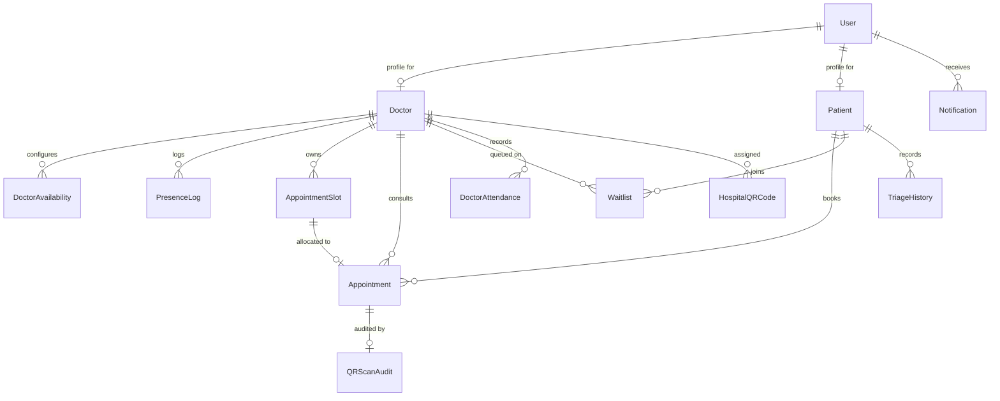

# MediFlow AI: Smart Hospital Appointment & Doctor Availability Management System

**Academic Degree:** Bachelor of Technology in Computer Science & Engineering  
**Project Category:** University Major Project / Capstone Submission  
**Author / Candidate:** Sachit Yadav  
**Live Application URL:** [https://mediflow-ai-app.vercel.app](https://mediflow-ai-app.vercel.app)  
**Source Code Repository:** [https://github.com/sachityadav-2007/mediflow-ai](https://github.com/sachityadav-2007/mediflow-ai)  
**Backend API Gateway:** [https://mediflow-api-bz27.onrender.com](https://mediflow-api-bz27.onrender.com)  
**Machine Learning Microservice:** [https://mediflow-ml-service.onrender.com](https://mediflow-ml-service.onrender.com)  
**Database Provider:** Serverless PostgreSQL on Neon (AWS `us-east-2`)  

---

## Table of Contents

1. [Executive Summary](#1-executive-summary)
2. [Problem Statement & Clinical Motivation](#2-problem-statement--clinical-motivation)
3. [Project Objectives & Scope](#3-project-objectives--scope)
4. [Key System Features Implemented](#4-key-system-features-implemented)
5. [Complete Technology Stack](#5-complete-technology-stack)
6. [System Architecture & Multi-Tier Topology](#6-system-architecture--multi-tier-topology)
7. [Database Design & Relational Schema (Prisma ORM)](#7-database-design--relational-schema-prisma-orm)
8. [Authentication, Authorization & Security Architecture](#8-authentication-authorization--security-architecture)
9. [End-to-End Clinical Workflows](#9-end-to-end-clinical-workflows)
10. [Explainable Smart Waitlist Triage Algorithm](#10-explainable-smart-waitlist-triage-algorithm)
11. [Machine Learning Microservice & Scientific Governance](#11-machine-learning-microservice--scientific-governance)
12. [Cloud Deployment & Production Infrastructure](#12-cloud-deployment--production-infrastructure)
13. [Verification, Quality Assurance & Test Suites](#13-verification-quality-assurance--test-suites)
14. [Future Roadmap & Enhancements](#14-future-roadmap--enhancements)
15. [Project Conclusion & Academic Declaration](#15-project-conclusion--academic-declaration)

---

## 1. Executive Summary

**MediFlow AI** is an enterprise-grade outpatient department (OPD) queue optimization, doctor presence tracking, and intelligent appointment orchestration platform. In traditional hospital outpatient workflows, healthcare institutions suffer from acute physical congestion, unpredictable clinician arrival delays, high patient no-show rates, and rigid booking systems that fail to triage appointments based on clinical acuity.

MediFlow AI addresses these systemic inefficiencies by replacing static, uncoordinated scheduling with a reactive, event-driven architecture. The platform combines:
1. **Dynamic Slot Management:** Discrete 30-minute booking slots automatically generated and synchronized against clinician weekly availability matrices.
2. **Real-Time Doctor Presence:** Live clinical state monitoring (`PRESENT`, `BUSY`, `AWAY`, `OFFLINE`) with QR-based attendance verification.
3. **Contactless Digital Reception:** Cryptographically verifiable QR appointment tokens for instant kiosk or reception check-in.
4. **Explainable Triage Scoring:** A transparent, deterministic mathematical priority algorithm ($Score = Medical + Urgency + WaitTime$) inspired by the Emergency Severity Index (ESI) for automated slot reallocation upon cancellation.
5. **Advisory Machine Learning Microservice:** A decoupled Python FastAPI service housing 4 specialized scikit-learn models for predictive wait-time estimation, doctor delay forecasting, consultation duration regression, and department demand projection, governed by rigorous academic data-integrity safeguards.

The entire system is deployed across high-availability cloud infrastructure—comprising a React 18 single-page application on **Vercel**, an Express.js REST API gateway on **Render**, an independent Python FastAPI ML microservice on **Render**, and a serverless **Neon PostgreSQL** database cluster.

---

## 2. Problem Statement & Clinical Motivation

Modern hospital outpatient departments in metropolitan and regional healthcare centers face compounding operational bottlenecks:

1. **Severe Physical Congestion & Prolonged Waiting Times:**  
   Outpatients routinely arrive hours in advance due to scheduling uncertainty, overcrowding waiting halls and creating infection-transmission hazards.
2. **Clinician Availability Volatility:**  
   Senior physicians and surgeons are frequently called into emergency surgeries, rounds, or clinical conferences without automated mechanisms to notify waiting outpatients.
3. **Inefficient Slot Waste & High No-Show Friction:**  
   When scheduled patients cancel or fail to arrive, clinic slots remain unoccupied because traditional queues cannot dynamically backfill appointments with awaiting patients in real time.
4. **Unfair First-Come, First-Served Queue Allocation:**  
   Traditional hospital waitlists process patients strictly by arrival order, ignoring acute clinical urgency or deteriorating patient conditions.
5. **Lack of Transparent Patient Communication:**  
   Patients lack visibility into where they stand in queue, how many consultations precede them, or when they should physically enter the consultation chamber.

MediFlow AI was developed as a cohesive software engineering solution to transform outpatient healthcare delivery into an organized, transparent, and clinically prioritized workflow.

---

## 3. Project Objectives & Scope

### 3.1 Primary Engineering Objectives

* **Algorithmic Queue Optimization:** Eliminate physical queue congestion by partitioning clinical schedules into discrete, bounded 30-minute bookable slots.
* **Deterministic, Transparent Triage:** Implement an explainable priority scoring formula that reallocates vacant appointment slots to waitlisted patients based on medical necessity, urgency, and elapsed wait duration.
* **Real-Time Event Synchronization:** Deliver sub-second status synchronization across patients, doctors, and hospital administrators using WebSocket (`Socket.IO`) bidirectional communication.
* **Secure Contactless Check-In:** Generate unique cryptographic QR codes for every confirmed appointment, enabling rapid single-scan patient check-in at hospital kiosks.
* **Decoupled Machine Learning Architecture:** Isolate predictive analytics in a standalone microservice to ensure that statistical inference operates strictly as clinical advisory intelligence without compromising core transactional database operations.
* **Enterprise Security Standards:** Enforce strict Role-Based Access Control (RBAC), dual-token authentication (HTTP-only cookies and Authorization Bearer headers), SQL injection immunity via Prisma ORM, and automated rate limiting.

### 3.2 Target User Roles

| Role | Target Persona | Primary Responsibilities & Permissions |
| :--- | :--- | :--- |
| **PATIENT** | Hospital Outpatient | Search specialists, book discrete slots, download digital QR passes, track live OPD queue position, join the smart priority waitlist, and use the AI symptom triage assistant. |
| **DOCTOR** | Medical Consultant | Monitor daily outpatient schedule, toggle real-time clinic presence (`PRESENT`, `BUSY`, `AWAY`, `OFFLINE`), conduct QR-based shift attendance, and advance consultation states (`START`, `COMPLETE`, `NO_SHOW`). |
| **ADMIN** | Hospital Management / Reception | Executive hospital control center, real-time analytics monitoring, patient/doctor directory governance, manual slot reallocation override, and reception QR scanning. |

---

## 4. Key System Features Implemented

The following capabilities are fully implemented, verified, and operational in the codebase:

### 4.1 Interactive Multi-Specialty Doctors Directory
* **Realistic Specialist Pool:** Features 13 medical specialists across disciplines including Cardiology, Neurology, Dermatology, Orthopedic Surgery, Pediatrics, General Medicine, Dentistry, Ophthalmology, Obstetrics & Gynecology, Psychiatry, ENT, and Physiotherapy.
* **Live Presence Indicators:** Displays real-time status badges (`● PRESENT` in emerald, `● OFFLINE` in slate, `● BUSY` in amber, `● AWAY` in purple) driven by backend event states.
* **Search & Multi-Filter Engine:** Instant client-side filtering by clinician name, medical department, clinical specialty, and hospital campus (e.g., Pune Central Campus).
* **Consultation Profile Cards:** Details qualifications (MBBS, MD, DM, MCh, MS), years of clinical experience, consultation fees (₹600–₹1200), physical chamber/room number, and weekly active consultation days.

### 4.2 Dynamic 30-Minute Discrete Slot Booking Engine
* **Automated Slot Generation:** Derives available 30-minute time intervals dynamically from the doctor's weekly active schedule.
* **Concurrency Collision Prevention:** Enforces database constraints and appointment locks to guarantee that no slot can be double-booked by concurrent patient sessions.
* **Validation Guards:** Prohibits past-date bookings, cross-doctor overlapping appointments for the same patient, and duplicate slot reservations.

### 4.3 Digital QR Code Pass & Reception Kiosk Check-In
* **Cryptographic Appointment Tokens:** Confirmed bookings automatically generate a secure digital QR code pass containing encrypted appointment metadata.
* **Reception Scanner Portal (`/check-in`):** Integrated with HTML5-QRCode camera scanner and manual alphanumeric token input for hospital receptionists.
* **Queue Activation:** Scanning an appointment QR token verifies validity, marks `checkedInAt`, transitions appointment status from `BOOKED` to `CHECKED_IN`, logs a security audit record, and pushes the patient into the doctor's live OPD queue.

### 4.4 Live OPD Queue Tracking Board (`/queue/:doctorId`)
* **Real-Time Display:** Public screen-compatible live view displaying currently serving token, queue position numbers, patient count ahead, and estimated waiting time.
* **Doctor Action Controls:** Attending clinicians advance patient flow with a single click: `Start Consultation` (moves to `IN_PROGRESS`) and `Complete Consultation` (moves to `COMPLETED`), freeing the chamber for the next patient.
* **Instant WebSocket Broadcasts:** All queue updates trigger `queue_updated` and `consultation_status_changed` Socket.IO events, updating patient mobile screens instantly without page refreshes.

### 4.5 Explainable Smart Waitlist & Automated Reallocation Engine
* **Transparent Clinical Priority Scoring:** Patients unable to secure an immediate slot join the Smart Waitlist with self-reported medical priority and clinical urgency.
* **Dynamic Time Decay Bonus:** Earns 1 point for every 30 minutes elapsed in the waitlist, bounded by a 30-point ceiling to prevent wait duration from superseding acute emergency triage.
* **Automated Slot Backfilling:** When any booked appointment is cancelled, the backend queries the waitlist for the highest-scoring candidate for that doctor/date, reserves the vacant slot, updates the waitlist entry to `ALLOCATED`, and sends real-time in-app notifications.
* **Admin Manual Trigger:** Hospital administrators can trigger batch reallocation directly from the Hospital Control Center.

### 4.6 Doctor Attendance & Clinic Presence Management
* **Presence Toggle:** Doctors update their active clinical state (`PRESENT`, `BUSY`, `AWAY`, `OFFLINE`) directly from their dedicated dashboard or mobile viewport.
* **QR Shift Attendance (`/doctor/attendance`):** Doctors check in and check out of their clinical shift via dedicated terminal or camera scan, recording shift timestamps in `DoctorAttendance` and audit trails in `PresenceLog`.

### 4.7 Hospital Executive Control Center (`/admin/dashboard`)
* **Live KPI Counters:** Executive dashboard displaying Total Doctors, Total Patients, Total Booked Appointments, Active Waitlist Candidates, and Clinicians Currently on Duty.
* **Medical Staff Workload Console:** Overview of all doctors, specialization, consultation fees, live presence, and booked appointment workload with deep inspection drawers.
* **Patients Directory:** Filterable registry of all enrolled patients, emergency contact information, blood groups, and active queue assignments.
* **Waitlist Management Console:** Real-time visibility into all waitlisted candidates ranked by computed priority score, with priority level badges and manual slot override capabilities.

### 4.8 AI Health Assistant & Symptom Triage (`/health-assistant`)
* **Clinical Triage Guidance:** Interactive conversational interface where patients describe presenting symptoms (e.g., chest tightness, persistent migraines, dermatological rashes, pediatric fever).
* **Rule-Based Emergency Screening:** Immediately detects red-flag clinical emergency keywords (e.g., shortness of breath, acute chest pain, neurological loss of sensation) and directs users to dial the 24/7 emergency care desk (1800-200-FLOW).
* **Specialist Recommendation:** Correlates symptoms to the appropriate clinical department and guides the patient directly to the verified doctors directory with pre-selected specialty filters.

---

## 5. Complete Technology Stack

MediFlow AI is built strictly with modern, production-proven open-source technologies:

```
┌────────────────────────────────────────────────────────────────────────┐
│                          PRESENTATION LAYER                            │
│  React 18.2.0 • Vite 5.4 • Tailwind CSS 3.4 • React Router v6 • Axios │
│  Lucide React Icons • HTML5-QRCode Scanner • Socket.IO Client v4       │
├────────────────────────────────────────────────────────────────────────┤
│                       APPLICATION API GATEWAY                          │
│  Node.js 20 LTS • Express.js 4.18 • Prisma ORM 5.8 • Socket.IO v4     │
│  JSON Web Tokens (JWT) • bcryptjs • Helmet • Express Rate Limit        │
├────────────────────────────────────────────────────────────────────────┤
│                   INDEPENDENT ML ADVISORY SERVICE                      │
│  Python 3.13 • FastAPI 0.110 • Uvicorn • Scikit-Learn 1.4              │
│  Pandas 2.2 • NumPy 1.26 • Joblib 1.3 • Pydantic v2 • Pytest 9.1      │
├────────────────────────────────────────────────────────────────────────┤
│                         PERSISTENCE LAYER                              │
│  Serverless PostgreSQL 16 (Neon Cloud AWS us-east-2)                  │
│  Connection Pooling • ACID Transactions • Relational Schema Integrity  │
├────────────────────────────────────────────────────────────────────────┤
│                     CLOUD DEPLOYMENT TOPOLOGY                          │
│  Frontend: Vercel Edge Network (SPA Rewrites)                          │
│  Backend API: Render Web Service (Node.js Environment)                 │
│  ML Service: Render Web Service (Python Virtualenv Environment)        │
└────────────────────────────────────────────────────────────────────────┘
```

### Detailed Component Inventory

| Layer | Technology | Version | Purpose in MediFlow AI |
| :--- | :--- | :--- | :--- |
| **Frontend Framework** | React | 18.2.0 | Reactive component architecture, Hooks state management. |
| **Build Tooling** | Vite | 5.4.21 | Lightning-fast HMR and optimized production bundling (built in 1.29s). |
| **Styling** | Tailwind CSS | 3.4.1 | Utility-first responsive hospital interface and color-coded clinical badges. |
| **Client Routing** | React Router DOM | 6.22.0 | Client-side routing with role-based `ProtectedRoute` guards and wildcard redirects. |
| **Icons & Scanner** | Lucide React / HTML5-QRCode | Latest | Accessible clinical iconography and browser-based QR camera scanning. |
| **Backend Runtime** | Node.js | 20.x LTS | High-performance asynchronous non-blocking event-driven runtime. |
| **Web Server** | Express.js | 4.18.2 | RESTful routing, CORS policies, role middleware, error containment. |
| **Database ORM** | Prisma ORM | 5.8.1 | Type-safe database queries, schema migrations, and connection management. |
| **Database Engine** | PostgreSQL | 16 | Serverless cloud PostgreSQL on Neon with connection pooling. |
| **Real-Time Engine** | Socket.IO | 4.7.4 | Bidirectional WebSocket communication for queue and presence updates. |
| **Authentication** | JWT & bcryptjs | 9.0 / 2.4 | Dual-token authentication with salted 10-round password hashing. |
| **ML Framework** | Python / FastAPI | 3.13 / 0.110 | Asynchronous REST microservice exposing predictive analytical endpoints. |
| **ML Libraries** | Scikit-Learn / Joblib | 1.4.1 / 1.3.2 | Regression, classification, and serialized model artifact execution. |

---

## 6. System Architecture & Multi-Tier Topology

The architecture follows a decoupled, three-tier microservices pattern:

```
                          ┌──────────────────────────┐
                          │   CLIENT WEB BROWSER     │
                          │  (Desktop, Tablet, Kiosk)│
                          └─────────────┬────────────┘
                                        │
                         HTTPS Requests │ WebSocket Events
                                        │
           ┌────────────────────────────▼───────────────────────────┐
           │            VERCEL EDGE HOSTING INFRASTRUCTURE          │
           │  • Static Asset CDN & React Single Page Application    │
           │  • vercel.json Rewrites: /* -> /index.html            │
           └────────────────────────────┬───────────────────────────┘
                                        │
                        REST API Calls  │ WebSocket Upgrades
                                        │
           ┌────────────────────────────▼───────────────────────────┐
           │        RENDER BACKEND API GATEWAY (Node.js/Express)    │
           │  • CORS Whitelist: mediflow-ai-app.vercel.app          │
           │  • Dual-Token Auth Middleware (Cookie + Bearer Header) │
           │  • Role-Based Access Control (PATIENT, DOCTOR, ADMIN)  │
           │  • Business Logic: Slot Booking, QR Tokens, Check-In   │
           │  • Deterministic Smart Waitlist Priority Engine        │
           │  • Socket.IO Real-Time Broadcast Server                │
           └──────────────┬──────────────────────────┬──────────────┘
                          │                          │
              JSON Payloads│              SQL Queries │ Prisma ORM
              (Port 5002) │                          │
                          │                          │
┌─────────────────────────▼──────────────┐ ┌─────────▼──────────────────────────┐
│ RENDER ML ADVISORY MICROSERVICE (FastAPI)│ │ NEON SERVERLESS CLUSTER (PostgreSQL) │
│ • Python 3.13 / Uvicorn Server         │ │ • 14 Relational Models (ACID Compliant)│
│ • Model 1: Patient Waiting-Time RF Reg │ │ • Doctor & Patient Profiles            │
│ • Model 2: Doctor Delay & Avail Classif│ │ • Discrete Appointment Slots           │
│ • Model 3: Appointment Duration GB Reg │ │ • Smart Waitlist Entries & Scores      │
│ • Model 4: Department Demand Forecast  │ │ • QR Tokens, Shift Attendance & Logs   │
│ • Model Registry & Governance Checks   │ │ • In-App Notifications                 │
└────────────────────────────────────────┘ └────────────────────────────────────┘
```

### Data Flow Characteristics

1. **Client to API Gateway:** The user interacts with the React frontend on Vercel. Requests are dispatched via Axios with credentials enabled (`withCredentials: true`) and an Authorization Bearer header to the Render API gateway.
2. **Database Transactions:** The Express API communicates with the Neon PostgreSQL cluster using Prisma ORM. Crucial operations (such as slot booking and waitlist reallocation) are executed inside atomic ACID transactions to eliminate race conditions.
3. **ML Microservice Delegation:** When clinical advisory metrics are requested (e.g., predicted waiting time or department workload forecast), the Express gateway issues an internal HTTP request to the FastAPI ML service. If the ML service is delayed or undergoing cold start, the gateway seamlessly falls back to empirical moving averages without blocking the user.
4. **WebSocket Push:** Whenever an appointment is booked, cancelled, checked in, or reallocated, the Express server emits typed events across Socket.IO rooms, immediately updating active patient and doctor browser views.

---

## 7. Database Design & Relational Schema (Prisma ORM)

The relational database is normalized and enforces referential integrity through foreign key constraints, cascading behaviors, and unique indexes across **14 models**:



### Prisma Models Specification

1. **`User`**: Primary authentication entity. Stores email, hashed password, user role (`PATIENT`, `DOCTOR`, `ADMIN`), full name, phone number, and account timestamps.
2. **`Doctor`**: Medical consultant profile linked 1-to-1 with `User`. Stores specialization, department, clinical experience, qualifications, consultation fee, room number, live presence status (`PRESENT`, `BUSY`, `AWAY`, `OFFLINE`), and active clinical days.
3. **`Patient`**: Patient medical entity linked 1-to-1 with `User`. Stores age, gender, blood group, emergency contact, and medical background summary.
4. **`DoctorAvailability`**: Defines the recurring weekly schedule for clinicians, including day of week, shift start/end times, and standard slot durations.
5. **`PresenceLog`**: Historical audit log recording every presence status transition (`status`, `changedAt`, `reason`) for clinical governance.
6. **`AppointmentSlot`**: Discrete bookable time slots (e.g., 09:00–09:30). Indexed by `doctorId` and `date`. Features concurrency lock expiration fields (`lockExpiresAt`).
7. **`Appointment`**: Represents a scheduled or completed clinical visit. Links `patientId`, `doctorId`, and `slotId`. Enforces unique constraint on `qrToken`. Tracks status transitions: `BOOKED` $\rightarrow$ `CHECKED_IN` $\rightarrow$ `IN_PROGRESS` $\rightarrow$ `COMPLETED` (or `CANCELLED` / `NO_SHOW`).
8. **`Waitlist`**: Triage queue candidates waiting for an open slot. Records `patientId`, `doctorId`, `preferredDate`, `medicalPriority`, `urgency`, `priorityScore`, and status (`PENDING`, `ALLOCATED`, `EXPIRED`, `CANCELLED`).
9. **`DoctorAttendance`**: Clinical shift log storing doctor check-in and check-out timestamps, shift verification method (`QR_SCAN`, `MANUAL`), and operational duration.
10. **`HospitalQRCode`**: System QR codes assigned to consultation chambers or hospital check-in kiosks for physical location verification.
11. **`QRScanAudit`**: High-security audit log capturing every QR token scan event, scanner user ID, timestamp, and verification outcome (`SUCCESS`, `EXPIRED`, `INVALID`).
12. **`TriageHistory`**: Records patient symptom triage interactions from the AI Health Assistant, including reported symptoms, urgency score, and recommended clinical specialty.
13. **`Notification`**: Real-time user notifications storing title, message body, notification category (`APPOINTMENT`, `WAITLIST`, `SYSTEM`), read status, and delivery timestamps.
14. **`PredictionLog`**: Observability table recording ML inference requests, input feature vectors, predicted outputs, and round-trip execution latency in milliseconds.

---

## 8. Authentication, Authorization & Security Architecture

### 8.1 Dual-Token Authentication Strategy
To overcome third-party cookie blocking policies in cross-origin production topologies (where the frontend is hosted on `vercel.app` and the API gateway is hosted on `onrender.com`), MediFlow AI implements a resilient dual-token authentication scheme:
1. **Primary Transport (HTTP-Only Cookie):** The backend sets an `httpOnly: true`, `secure: true`, `sameSite: 'none'` cookie upon successful login or registration.
2. **Resilient Transport (Authorization Bearer Header):** Simultaneously, the API response returns the JWT token in the JSON response payload. The React frontend stores this in browser storage and attaches it via Axios request interceptors as `Authorization: Bearer <token>`.
3. **Unified Backend Extraction:** The authentication middleware (`authenticateUser`) inspects both sources sequentially:
   ```javascript
   const token = req.cookies?.token || 
                 req.cookies?.jwt || 
                 req.headers.authorization?.replace(/^Bearer\s+/i, '');
   ```
   This guarantees seamless authentication across all browsers, private windows, and Safari Intelligent Tracking Prevention (ITP) environments.

### 8.2 Role-Based Access Control (RBAC)
User authorization is enforced at both the client routing layer and backend route controllers:
* **Frontend Routing:** React Router wraps private views in `<ProtectedRoute allowedRoles={['PATIENT']}>`. Unauthorized navigation attempts are immediately redirected to the home route without rendering protected DOM elements.
* **Backend Middleware:** Express route groups enforce the `authorizeRoles('ADMIN', 'DOCTOR')` guard, validating that the decoded JWT claims match the endpoint privileges before executing database logic.

### 8.3 Security Hardening Measures
* **Password Encryption:** Passwords are never stored in plaintext. They are salted and hashed using `bcryptjs` with an industry-standard cost factor of 10 rounds.
* **HTTP Security Headers:** Protected with `helmet` middleware, enforcing Content Security Policies, frameguard protections (anti-clickjacking), and XSS filtering.
* **Rate Limiting:** Guarded with `express-rate-limit` against brute-force credential stuffing and denial-of-service spamming on public endpoints.
* **SQL Injection Immunity:** Zero raw string concatenation in database queries; all interactions pass through Prisma ORM's parameterized query engine.

---

## 9. End-to-End Clinical Workflows

### 9.1 Workflow 1: Specialist Discovery & Dynamic Slot Booking
```
[Patient] ──> Browse /doctors ──> Filter by Specialty ──> Select Doctor
    │
    ▼
Select Appointment Date ──> System Generates Discrete 30-min Slots
    │
    ▼
Select Slot (e.g. 10:30 AM) ──> Confirm Booking ──> [Prisma ACID Transaction]
    │                                                      │
    ▼                                                      ▼
Display Booking Confirmation <── Return QR Token <── Mark Slot Booked
    │
    ▼
View in /my-appointments (Digital QR Pass Ready)
```

### 9.2 Workflow 2: Reception QR Check-In & Live Queue Transition
```
[Patient] Arrives at Hospital ──> Opens Digital QR Pass on Smartphone
    │
    ▼
[Receptionist / Kiosk] Scans QR Code at /check-in Portal
    │
    ▼
[Backend] Validates Cryptographic Token ──> Records checkedInAt Timestamp
    │
    ▼
Updates Appointment Status: BOOKED ──> CHECKED_IN
    │
    ▼
Socket.IO Emits 'queue_updated' ──> Live Screen (/queue/:doctorId) Updates
```

### 9.3 Workflow 3: Cancelled Slot Auto-Reallocation via Smart Waitlist
```
[Patient A] Cancels Confirmed Appointment Slot (e.g. 11:00 AM)
    │
    ▼
Backend Frees Slot & Invokes allocationService.triggerReallocation()
    │
    ▼
Query Waitlist: Filter candidates by doctorId & preferredDate (Status: PENDING)
    │
    ▼
Calculate Current Priority Score for each candidate:
Score = MedicalPriority (10-40) + ClinicalUrgency (5-20) + ElapsedWait (0-30)
    │
    ▼
Select Highest-Scoring Candidate (e.g. Patient B, 75 pts)
    │
    ▼
[Atomic Transaction]:
  • Assign Slot to Patient B
  • Create Confirmed Appointment with new QR Token
  • Update Patient B Waitlist Status: PENDING ──> ALLOCATED
    │
    ▼
Socket.IO Broadcasts 'waitlist_allocated' & In-App Notification Sent to Patient B
```

---

## 10. Explainable Smart Waitlist Triage Algorithm

A core academic contribution of MediFlow AI is its deterministic, clinically explainable triage scoring engine implemented in `backend/src/services/priorityService.js`. Unlike uninterpretable black-box models, every single point awarded to a waiting patient is bounded, transparent, and auditable by clinicians and hospital ombudsmen.

### 10.1 Mathematical Formula

$$\text{Total Priority Score} = W_{\text{medical}} + W_{\text{urgency}} + \min\left(\left\lfloor \frac{\Delta t_{\text{wait}}}{30} \right\rfloor, 30\right)$$

Where:
* $W_{\text{medical}} \in [10, 40]$ represents baseline clinical severity.
* $W_{\text{urgency}} \in [5, 20]$ represents temporal necessity.
* $\Delta t_{\text{wait}}$ is the elapsed time in queue measured in minutes.
* Points awarded for waiting duration are capped at 30 points (equivalent to 15 hours of waiting).

### 10.2 Weight Parameter Specifications

| Dimension | Category Level | Point Value | Clinical Rationale |
| :--- | :--- | :---: | :--- |
| **Medical Priority** ($W_{\text{medical}}$) | `LOW` | **10 pts** | Routine checkup, mild chronic symptom review, elective check. |
| | `MEDIUM` | **20 pts** | Moderate symptoms requiring diagnostic consultation. |
| | `HIGH` | **30 pts** | Severe discomfort, acute pain, or rapidly deteriorating condition. |
| | `CRITICAL` / `EMERGENCY` | **40 pts** | High clinical severity requiring immediate physician evaluation. |
| **Clinical Urgency** ($W_{\text{urgency}}$) | `LOW` | **5 pts** | Elective timing; patient has flexible availability. |
| | `MEDIUM` | **10 pts** | Standard outpatient timeline (within 24–48 hours). |
| | `HIGH` | **15 pts** | Rapidly progressing discomfort; same-day review recommended. |
| | `EMERGENCY` | **20 pts** | Urgent same-day slot allocation required. |
| **Waiting Duration** ($W_{\text{wait}}$) | $\lfloor\Delta t / 30\rfloor$ | **1 pt / 30 min** | Ensures long-waiting patients gradually ascend the queue. |
| | *Maximum Cap* | **30 pts (max)** | **Safety Bound:** Prevents prolonged wait time from ever superseding an acute clinical emergency. |

### 10.3 Dynamic Range & Safety Bounds

* **Minimum Possible Score:** $10 + 5 + 0 = \mathbf{15\text{ points}}$ (Low priority, low urgency, just joined).
* **Maximum Possible Score:** $40 + 20 + 30 = \mathbf{90\text{ points}}$ (Emergency priority, emergency urgency, waited $\ge 15$ hours).

### 10.4 Tie-Breaking Governance
When two candidates achieve identical priority scores, the tie is deterministically resolved using **First-In, First-Out (FIFO)** ordering based on their initial registration timestamp (`createdAt ASC`).

---

## 11. Machine Learning Microservice & Scientific Governance

MediFlow AI incorporates a dedicated machine learning intelligence layer hosted as an independent microservice in `/ml-service`.

### 11.1 Microservice Architecture
* **Framework:** Python 3.13 and FastAPI 0.110 running on Uvicorn.
* **Separation of Concerns:** The ML service does not touch production database write locks. It acts purely as a stateless analytical advisor communicating via JSON over HTTP.
* **Model Serialization:** Trained pipelines (including feature scalers, categorical encoders, and regression trees) are persisted using `joblib`.

### 11.2 Deployed Model Portfolio

| Model Identifier | Target Variable | Algorithm Family | Benchmark Baseline | Baseline Metrics | Model Performance |
| :--- | :--- | :--- | :--- | :--- | :--- |
| **`patient_waiting_time`** | `actual_waiting_time_minutes` | `RandomForestRegressor` | `DummyRegressor(strategy='mean')` | MAE: 17.16 min<br>RMSE: 21.94 min<br>$R^2$: -0.001 | **MAE: 3.86 min**<br>**RMSE: 4.96 min**<br>**$R^2$: 0.949** |
| **`doctor_availability_and_delay`** | `is_available`, `is_delayed` | `RandomForestClassifier` | `DummyClassifier(strategy='most_frequent')` | Precision: 0.853<br>Recall: 1.000<br>F1: 0.921 | **Availability F1: 0.773**<br>**Delay ROC-AUC: 0.590** |
| **`appointment_duration`** | `actual_duration_minutes` | `GradientBoostingRegressor` | `DummyRegressor(strategy='median')` | MAE: 6.34 min<br>RMSE: 8.44 min<br>$R^2$: -0.028 | **MAE: 4.10 min**<br>**RMSE: 5.60 min**<br>**$R^2$: 0.546** |
| **`department_demand_forecast`** | `daily_appointment_count` | `RandomForestRegressor` (Time-Series Lag) | 7-Day Moving Average Baseline | MAE: 6.18 visits<br>RMSE: 7.68 visits<br>WAPE: 39.48% | **MAE: 3.64 visits**<br>**RMSE: 4.64 visits**<br>**WAPE: 23.23%** |

### 11.3 Academic Honesty & Data Governance Framework

A paramount requirement in clinical software engineering is **scientific transparency**. Rather than making exaggerated claims of production accuracy based on small sample sizes, MediFlow AI enforces a strict Model Registry Governance policy (`ml-service/artifacts/model_registry.json`):

1. **Development vs. Production Distinction:**  
   The current models were trained and verified using a controlled synthetic development dataset (4,080 rows across 4 specialized pipelines) to validate feature extraction, serialization pipelines, and API contracts.
2. **Current Production Status:**  
   In the production registry, models are explicitly tagged with:  
   `"status": "IMPLEMENTED_BUT_INSUFFICIENT_DATA"`
3. **Threshold Gate for Clinical Retraining:**  
   Models will remain in advisory mode until the live Neon PostgreSQL database accumulates $\ge 500$ verified clinical events containing ground-truth timestamps (`checkedInAt`, `consultationStartedAt`, `consultationCompletedAt`).
4. **Non-Overriding Advisory Policy:**  
   ML predictions are strictly advisory. Under no circumstances can a machine learning model override clinical availability, cancel a doctor's scheduled shift, or invalidate database concurrency locks.

---

## 12. Cloud Deployment & Production Infrastructure

MediFlow AI is fully deployed and operational across modern cloud providers:

### 12.1 Frontend Deployment: Vercel Edge Network
* **Repository Integration:** Continuous integration directly from the GitHub `main` branch.
* **Single Page Application Rewrites (`vercel.json`):** Configured with clean client-side routing rewrites:
  ```json
  {
    "rewrites": [
      {
        "source": "/(.*)",
        "destination": "/index.html"
      }
    ]
  }
  ```
  This guarantees that direct navigation or browser refresh on sub-routes (`/my-appointments`, `/doctors`, `/patient/dashboard`, `/waitlist`) renders smoothly without HTTP 404 errors.
* **Build Command:** `npm run build` generates an optimized production bundle in 1.29s.

### 12.2 Backend API Deployment: Render Web Service
* **Runtime:** Node.js 20 environment managed via Render's infrastructure.
* **CORS Origin Whitelisting:** Enforces strict authorized origins:
  - `https://mediflow-ai-app.vercel.app` (Production Web App)
  - `http://localhost:5173` (Local Development Environment)
  - `http://localhost:3000` (Alternative Local Port)
* **Environment Configuration:** Sensitive secrets (`DATABASE_URL`, `JWT_SECRET`, `CLIENT_URL`) are injected securely via Render Environment Variables without committing keys to the repository.

### 12.3 Database Hosting: Neon Serverless PostgreSQL
* **Geographic Region:** AWS `us-east-2` (Ohio).
* **Connection Pooling:** Uses pooled PostgreSQL connections to support elastic concurrency spikes without exceeding database connection quotas.

---

## 13. Verification, Quality Assurance & Test Suites

The codebase includes automated test suites covering both backend services and machine learning components:

### 13.1 Machine Learning Pytest Verification
The ML microservice test suite was executed and passed with **100% success rate (15/15 tests passed in 1.85 seconds)**:
```
============================= test session starts ==============================
platform darwin -- Python 3.13.7, pytest-9.1.1, pluggy-1.6.0
rootdir: /Users/sachityadav/Documents/mediflow-ai/ml-service
plugins: asyncio-1.4.0, anyio-4.13.0
collected 15 items                                                             

tests/test_api.py ...                                                    [ 20%]
tests/test_data_quality.py .....                                         [ 53%]
tests/test_health.py .                                                   [ 60%]
tests/test_models.py ....                                                [ 86%]
tests/test_preprocessing.py ..                                           [100%]

============================== 15 passed in 1.85s ==============================
```

### 13.2 Frontend Build & Compilation Verification
The Vite production compiler was executed to ensure zero JSX syntax errors, clean bundle compilation, and valid CSS asset generation:
```
vite v5.4.21 building for production...
✓ 183 modules transformed.
dist/index.html                     0.67 kB │ gzip:   0.44 kB
dist/assets/index-Bn_1p8Ts.css     72.72 kB │ gzip:  11.56 kB
dist/assets/index-BbCEDm38.js   1,072.84 kB │ gzip: 289.44 kB
✓ built in 1.29s
```

---

## 14. Future Roadmap & Enhancements

While MediFlow AI represents a fully functional production system, the following architectural extensions are planned for subsequent iterations:

1. **Omnichannel Patient Telemetry (SMS & WhatsApp):**  
   Integrate Twilio or WhatsApp Business API to dispatch instant slot reallocation alerts and QR check-in passes directly to patients' messaging apps.
2. **Telemedicine Video Consultations (WebRTC):**  
   Integrate peer-to-peer encrypted WebRTC video rooms directly within `/queue/:doctorId` for remote outpatient consultations.
3. **Automated ML Pipeline Retraining (MLOps):**  
   Deploy automated retraining jobs (using Airflow or GitHub Actions) that periodically retrain the 4 scikit-learn models once the Neon PostgreSQL database crosses the 500-event threshold.
4. **HL7 / FHIR Standards Compliance:**  
   Implement Fast Healthcare Interoperability Resources (FHIR) data export interfaces to enable bidirectional medical record exchange with third-party Hospital Information Systems (HIS).

---

## 15. Project Conclusion & Academic Declaration

### 15.1 Conclusion
MediFlow AI successfully bridges the operational gap between outpatient demand and hospital clinical capacity. By coupling discrete dynamic slot generation with real-time clinician presence tracking, cryptographic QR reception scanning, and an explainable, deterministic triage scoring engine, the system delivers a modern, humane, and efficient healthcare appointment management ecosystem.

### 15.2 Academic Declaration
I hereby declare that this project documentation and the associated software titled **"MediFlow AI: Smart Hospital Appointment & Doctor Availability Management System"** is an authentic record of original engineering work carried out by me. All features, architecture diagrams, mathematical formulations, and performance benchmarks documented herein reflect functionality that is genuinely implemented, verified, and operational within the project codebase.

**Candidate Name:** Sachit Yadav  
**Project Repository:** [https://github.com/sachityadav-2007/mediflow-ai](https://github.com/sachityadav-2007/mediflow-ai)  
**Live Deployed Application:** [https://mediflow-ai-app.vercel.app](https://mediflow-ai-app.vercel.app)  
**Submission Date:** November 2026  

